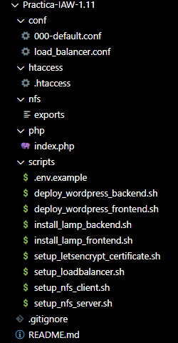

# Practica-IAW-1.11- Implantación de Wordpress en AWS utilizando una arquitectura de tres niveles

## Pasos previos a la instalación

**para la instalación vamos a tener que crear la siguiente estructura de directorios y archivos:**



**Una vez creados los archivos y directorios, procedemos a la Implantación de Wordpress en AWS utilizando una arquitectura de tres niveles.**

## Implantación de Wordpress en AWS utilizando una arquitectura de tres niveles

## 1. Creamos un nombre de dominio para nuestro servidor con la web `no-ip`

### Paso 1. Crear el nombre del dominio 

Para crear el nombre de dominio en la página, tenemos que registrarnos y dirigirnos al sitio que muestra la captura y darle a **crear nombre de host**.


Una vez dado al recuadro de crear el nombre, nos sale un asistente para poner el nombre de host que queramos, el dominio que queremos que lleve, la dirección ip de la máquina o pc que queremos que tenga ese nombre de host y el tipo de registro que queremos que lleve, en nuestro caso es el **DNS Host A**


Hecho esto ya podemos automatizar el proceso de la instalación del balanceador de carga con Nginx

## 1.1 Infraestructura necesaria

La infraestructura necesaria está compuesta de cuatro máquinas virtuales, una para el balanceador de carga (Load Balancer), dos como frontales web (Front-End) y una como servidor de base de datos MySQL (Back-End).

* Balanceador. (esta práctica)
* Frontal Web 1. (La de la anterior práctica. Práctica-IAW-1.9-Frontend)
* Frontal Web 2. (esta práctica, ya que tenemos dos máquinas, la del load balancer y el frontend2)
* Servidor de Base de Datos MySQL. (La de la anterior práctica. Práctica-IAW-1.9-Backend).

## 2. Creación del archivo `setup_loadbalancer` para la máquina loadbalancer

### Paso 1. Importamos el archivo de variables y mostramos los comandos que se van ejecutando 

```bash
source .env
```

```bash
set -ex
```

### Paso 2. Actualizamos los repositorios

```bash
apt update
```

### Paso 3. Actualizamos los paquetes

```bash
apt upgrade -y
```

### Paso 4. Instalamos Nginx

```bash
apt install nginx -y
```

### Paso 5. Deshabilitamos el enlace simbólico

```bash
unlink /etc/nginx/sites-enabled/default
```

> [!IMPORTANT]  
> Esto lo hacemos porque a continuación, vamos a crear un archivo personalizado para nuestro sitio.

### Paso 6. Creamos el archivo load_balancer.conf

```bash
upstream frontend_servers {
    server IP_FRONTEND_1;
    server IP_FRONTEND_2;
}

server {
    listen 80;
    server_name LE_DOMAIN;

    location / {
        proxy_pass http://frontend_servers;
    }
}
```

> [!IMPORTANT]  
> Las variables que irán apareciendo durante los pasos están todas definidas en el archivo `.env` y en `.env.example` se pueden ver las variables que hay que tener definidas.

### Paso 7. Copiamos el .conf a /etc/nginx/sites-available

```bash
cp ../conf/load_balancer.conf /etc/nginx/sites-available
```

### Paso 8. Modificamos el archivo copiado en la ruta correcta
```bash
sed -i "s/IP_FRONTEND_1/$IP_FRONTEND_1/" /etc/nginx/sites-available/load_balancer.conf
sed -i "s/IP_FRONTEND_2/$IP_FRONTEND_2/" /etc/nginx/sites-available/load_balancer.conf
sed -i "s/LE_DOMAIN/$LE_DOMAIN/" /etc/nginx/sites-available/load_balancer.conf
```

### Paso 9. Comprobamos que el archivo ya esté activo, y si no lo está, lo activamos

```bash
if [ ! -f "/etc/nginx/sites-enabled/load_balancer.conf" ]; then
ln -s /etc/nginx/sites-available/load_balancer.conf /etc/nginx/sites-enabled/
fi
```

### Paso 10. Reiniciamos nginx

```bash
systemctl reload nginx
```

## Comprobación de que el balanceador de carga funciona


